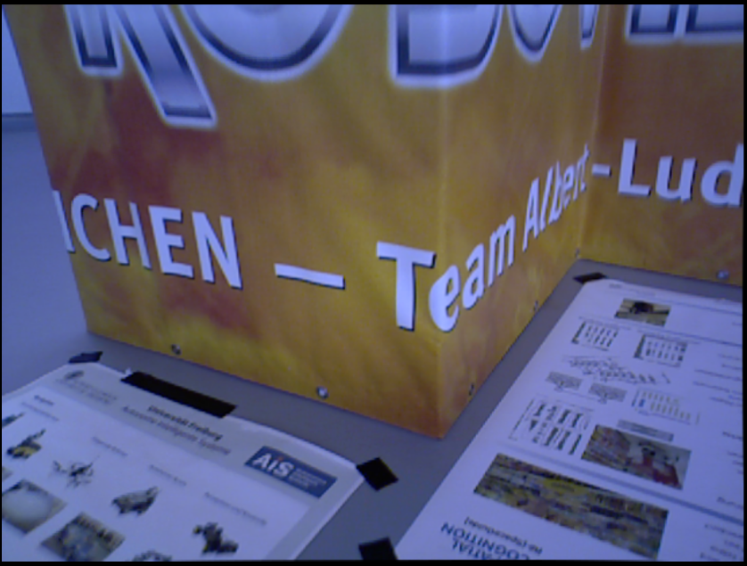
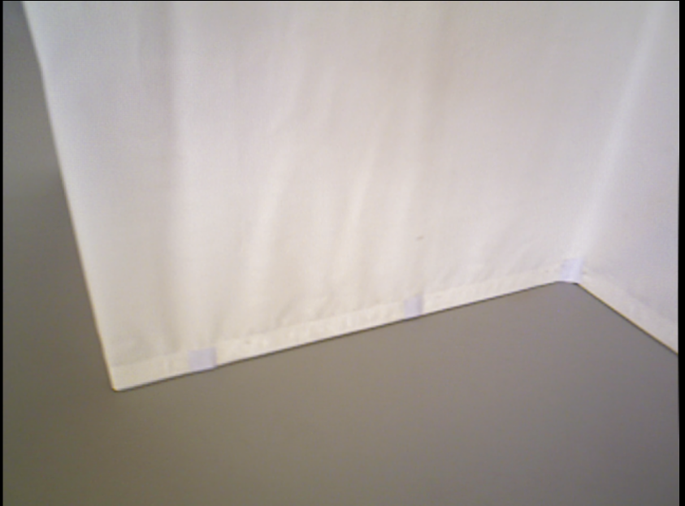
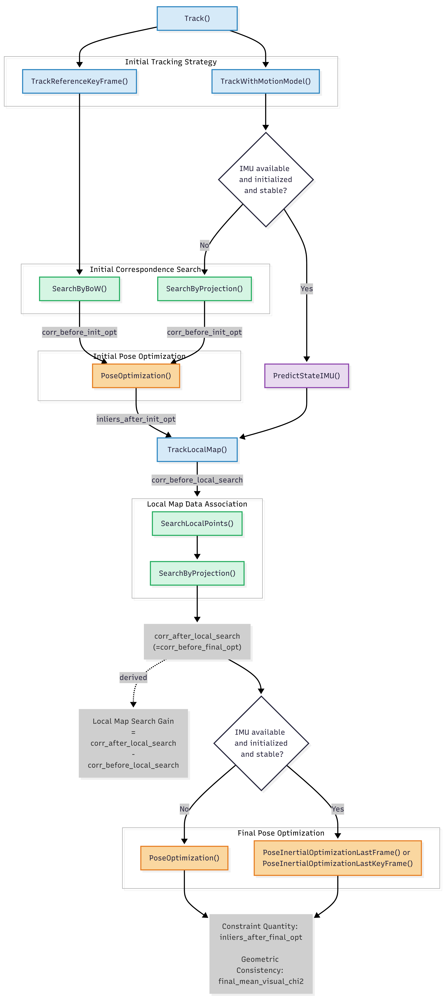
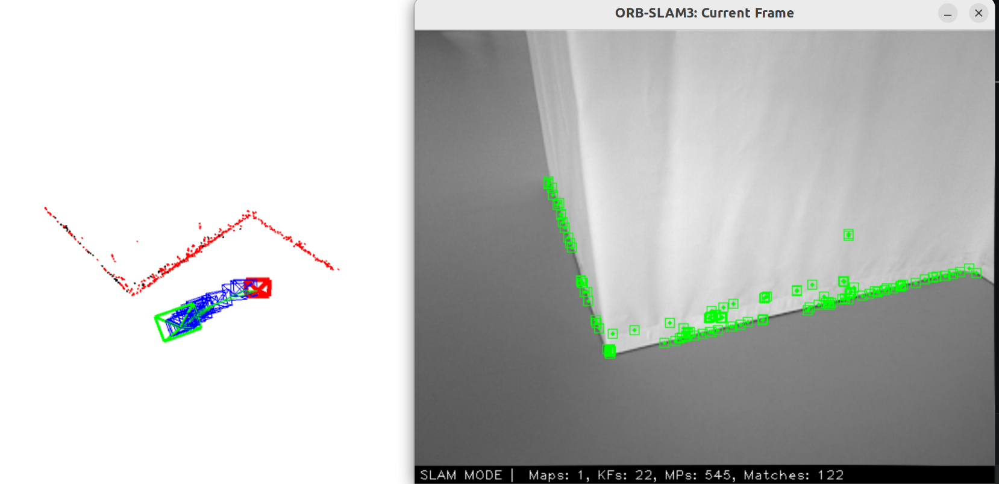
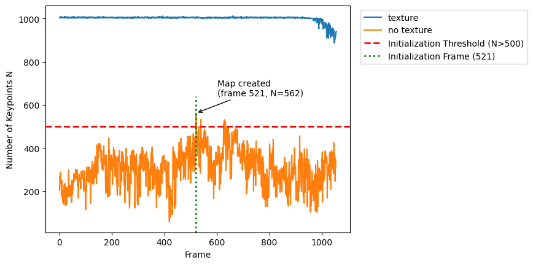
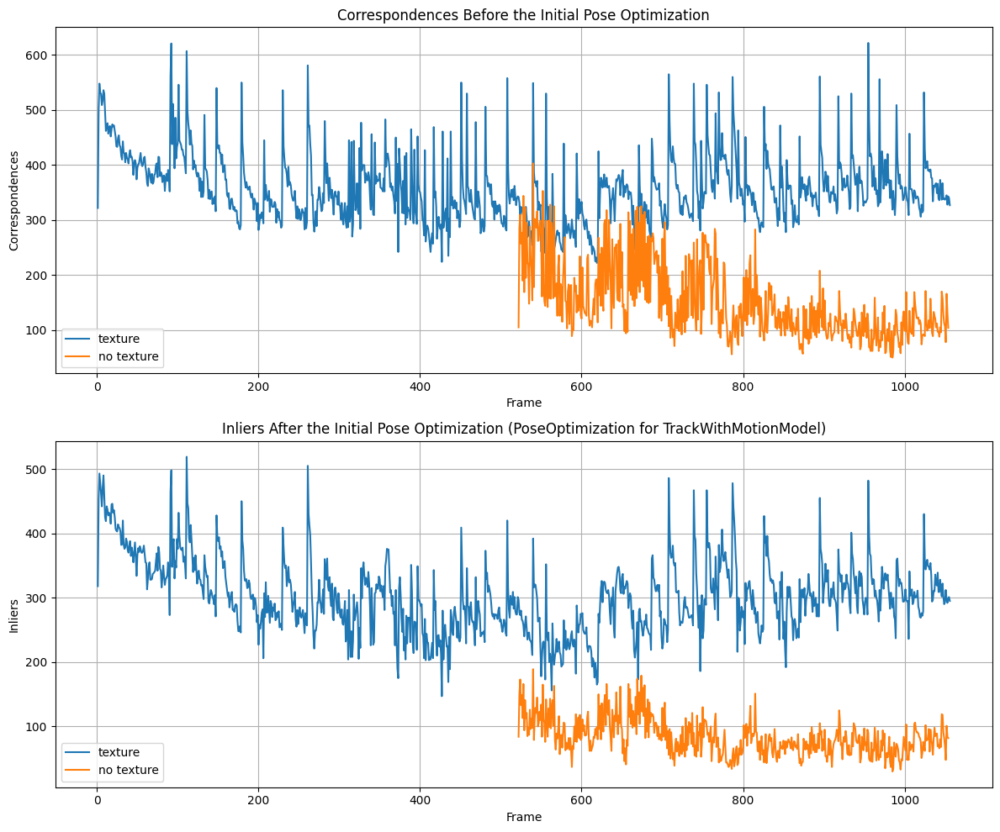
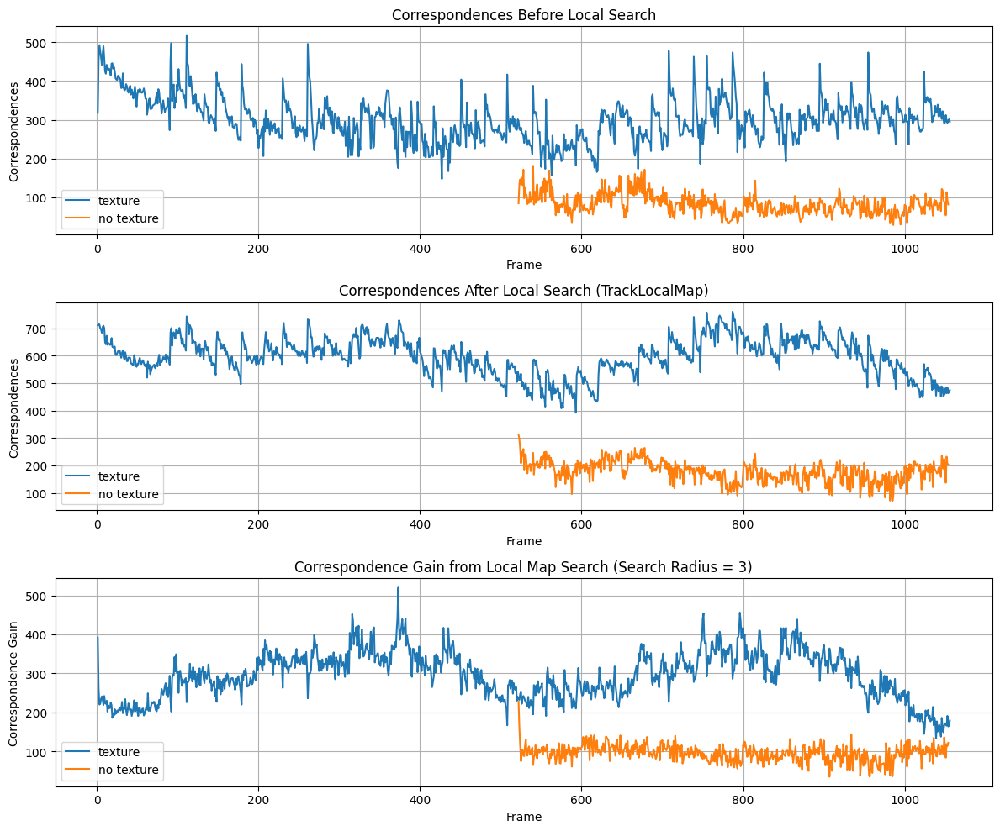
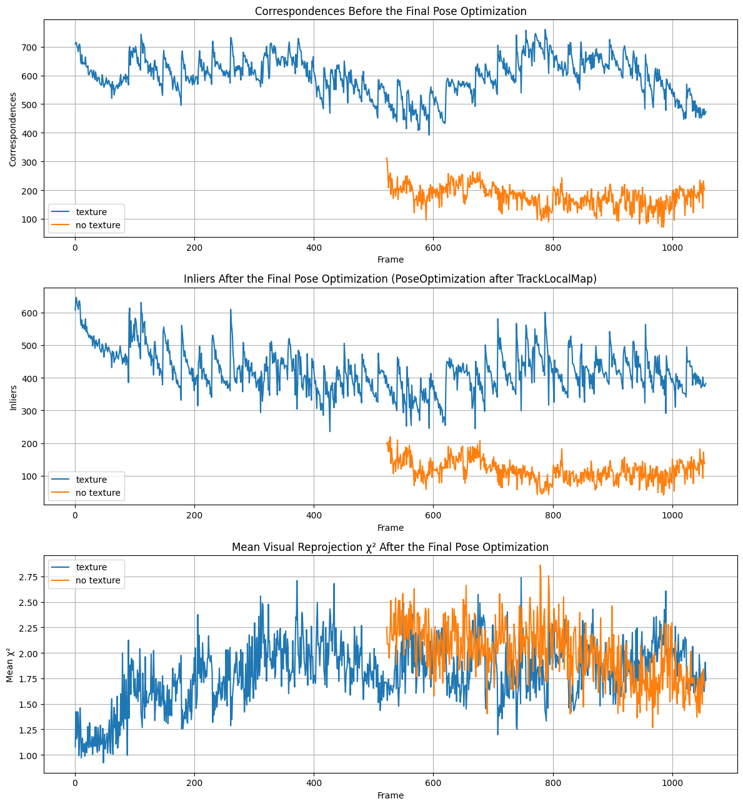
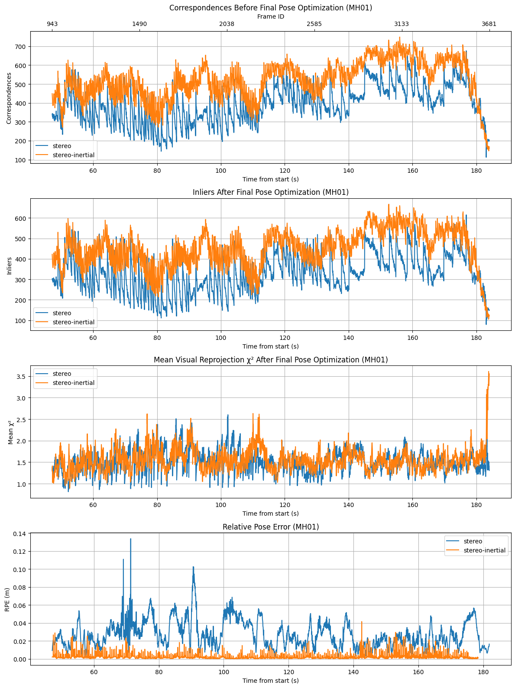
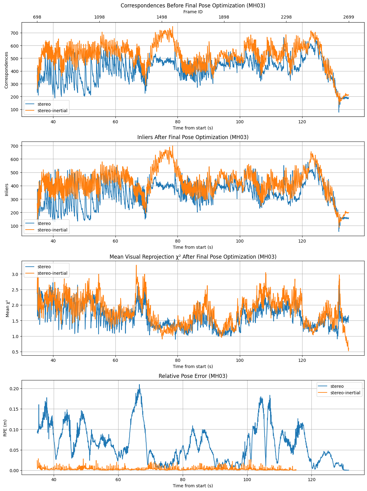

# Analysis of Tracking Behavior in Visual and Visual-Inertial SLAM (ORB-SLAM3)

## 1. Experimental Design

The experiments investigate the effects of **low-texture conditions** and **IMU integration** on ORB-SLAM3 tracking using selected sequences from the TUM RGB-D and EuRoC MAV datasets.

**Table 1.1 Experimental Configurations**
| Experiment | Dataset Sequence | Condition  | 
|------------|---------|----------------------|
| **Low-texture analysis** | `rgbd_dataset_freiburg3_structure_texture_near` (TUM RGB-D) |  Texture | 
| | `rgbd_dataset_freiburg3_structure_notexture_near` (TUM RGB-D) | Low-texture | 
| **IMU integration analysis** | `MH_01_easy` (EuRoC MAV) | Lower rotational motion | 
| | `MH_03_medium` (EuRoC MAV) | Higher rotational motion | 

 

  
  

**Fig. 1.1 Representative RGB frames from the TUM RGB-D structure_texture (left) and structure_notexture (right) sequences**
 

**Table 1.2 EuRoC Angular Velocity Magnitude Statistics**

| Sequence | Mean (rad/s) | 95th Percentile (rad/s) | Samples > 1 rad/s (%) |
|----------|-------------:|------------------------:|-----------------------:|
| `MH_01_easy` | 0.217 | 0.528 | 0.087 |
| `MH_03_medium` | 0.288 | 0.737 | 0.463 |

**Note.** Statistics were computed from the IMU gyroscope measurements. MH03 exhibits higher rotational motion across reported metrics.

---

## 2. ORB-SLAM3 Tracking Pipeline and Instrumentation

Gray labels denote the metrics logged at each stage for tracking analysis.

| Tracking Stage                         | Logged metrics                                                               |
| ----------------------------- | ------------------------------------------------------------------------------ |
| Initial correspondence search | `corr_before_init_opt`                                                         |
| Initial pose optimization     | `inliers_after_init_opt`                                                       |
| Local map search         | `corr_before_local_search`, `corr_after_local_search`, `local_map_search_gain` |
| Final pose optimization       | `inliers_after_final_opt`, `final_mean_visual_chi2`                            |
- Correspondences `corr_*`: Number of visual data associations.
- Inliers `inliers_*`: Number of accepted correspondences after pose optimization.
- Mean visual χ² `*_chi2`: Average weighted squared reprojection residual of accepted visual constraints.

The logged `final_mean_visual_chi2` is computed from the weighted reprojection error used by ORB-SLAM3 during pose optimization:

$$
\chi^2 = \mathbf{e}^{T}\mathbf{\Omega}\mathbf{e}
$$

where

- $\mathbf{e}$: the reprojection residual vector
- $\mathbf{\Omega}$: the information matrix (the inverse of the measurement noise covariance matrix)

`final_mean_visual_chi2`: the mean χ² over all accepted visual edges after the final pose optimization
`inliers_after_final_opt`: the number of accepted edges

A lower `final_mean_visual_chi2` indicates that the accepted visual constraints are more geometrically consistent with the estimated pose, although it does not by itself guarantee correct data association.

---

## 3. Key Findings
| Finding | Observation |
|------------|-------------|
| **Low texture:**  Tracking coverage ↓ | Delayed map initialization due to insufficient ORB keypoints. Once initialized, tracking remains operational in the no-texture sequence. |
| **Low texture:**  Pose accuracy ↓ | Low texture reduces the number of accepted visual constraints. |
| **IMU integration:**  Pose accuracy ↑ | IMU integration increases the number of accepted visual constraints. |

----

## 4. Low-texture Analysis
### 4.1 Reduced Tracking Coverage under No-Texture Conditions

#### 4.1.1 Qualitative Observations

**Figure 4.1 ORB-SLAM3 viewer snapshot under no-texture conditions**

- Tracking remains operational throughout the no-texture sequence after the map initialization.
- Feature points are primarily detected along visible geometric boundaries and near corners.

#### 4.1.2 Results
**Table 4.1 Tracking Performance Comparison**

| Sequence    | Tracking Coverage | Total Frames |
| ---------- | ----------------: | -----------: |
| `rgbd_dataset_freiburg3_structure_texture_near` |             0.996 |         1057 |
| `rgbd_dataset_freiburg3_structure_notexture_near` |             0.506 |         1055 |

 

**Figure 4.2 ORB Keypoints and Delayed Map Initialization under No-Texture Conditions**

#### 4.1.3 Analysis
- Observation (Table 4.1):  
Coverage drops from 99.6% (texture) to 50.6% (no-texture).
 
- Source code inspection:  
Map initialization requires more than 500 keypoints (N > 500).  
See `Tracking.cc`, `Tracking::StereoInitialization()`.
 
- Instrumentation:  
Map initialization in the no-texture sequence occurs at frame 521 when N = 562 (Fig. 4.2).
 
- Verification: 
    - No-texture sequence length = 1055 frames
    - Initialization frame id = 521 
    - Calculated coverage when tracking starts at frame 521, (1055-521)/1055 = 0.506
 
- Measured coverage (Table 4.1):  
0.506
 
- Conclusion:   
The coverage loss can be explained by delayed map initialization under no-texture conditions.
 
- Insight:  
Low texture primarily affects map initialization rather than continuous tracking. In the structure-notexture sequence, once the initial map has been built, visual features detected along geometric boundaries can provide sufficient constraints to sustain pose tracking. (Fig.4.1).

### 4.2 Pose Accuracy Degradation under No-Texture Conditions
#### 4.2.1 Results

**Table 4.2 Tracking Relative Pose Error (RPE) Comparison**

| Sequence    | RPE RMSE (m) |
| ---------- | -----------|
| `rgbd_dataset_freiburg3_structure_texture_near` |      0.00874 |
| `rgbd_dataset_freiburg3_structure_notexture_near` |    0.01737 |

 

**Figure 4.3 Initial Pose Optimization: Texture vs. No-Texture**
 

**Figure 4.4 Local Map Search: Texture vs. No-Texture**
 

**Figure 4.5 Final Pose Optimization: Texture vs. No-Texture**

#### 4.2.2 Analysis
- Observation (Table 4.2):  
RPE RMSE increases from 0.008 m (texture) to 0.017 m (no-texture).
 
- Evidence from source-code instrumentation (Compared with the texture sequence, the no-texture sequence exhibits):
    - Fewer ORB keypoints (Fig. 4.2)
    - Initial pose optimization:
        - fewer correspondences before optimization and fewer inliers after optimization (Fig. 4.3)
    - Local map search:
        - reduced correspondence gain (Fig. 4.4)
    - Final pose optimization:
        - fewer correspondences before optimization, fewer inliers after optimization, while maintaining a similar mean visual χ² (Fig. 4.5)
 
- Interpretation:   
    In the tested sequences, Low texture mainly reduces the number of visual constraints, while the mean χ² of the accepted constraints remains relatively unchanged.
 
- Qualitative Observation (Fig. 4.1):
    Structural boundary lines and corners appear sufficient to maintain visual tracking, although with reduced accuracy and fewer visual constraints.
 
- Limitations:  
The TUM `rgbd_dataset_freiburg3_structure_texture_near` and `rgbd_dataset_freiburg3_structure_notexture_near` sequences provide similar structured indoor environments and motion patterns, but they are **not identical trajectories**. Therefore, the analysis should be interpreted as an qualitative comparison rather than a strictly controlled experiment.    
 
- Future Work:  
A more rigorous controlled study would use the same trajectory while removing texture, allowing texture to be isolated as the only changing factor.

## 5. IMU Integration Analysis
### 5.1 Results
**Table 5.1 Stereo and Stereo-Inertial Tracking Performance on EuRoC MAV**

| Sequence | Configuration | RPE RMSE (m) | Tracking Coverage | Total Frames |
|---------|---------------|-------------:|------------------:|-------------:|
| `MH_01_easy` | Stereo | 0.028353 | 0.988 | 3682 |
| `MH_01_easy` | Stereo-Inertial | 0.003660 | 0.970 | 3682 |
| `MH_03_medium` | Stereo | 0.071663 | 0.974 | 2700 |
| `MH_03_medium` | Stereo-Inertial | 0.005259 | 0.854 | 2700 |

**Note.** To ensure a fair comparison with the stereo-only configuration, the local map search radius for stereo-inertial configuration after IMU initialization was changed from **2** (ORB-SLAM3 default for stereo-inertial) to **1** (same as the stereo-only setting) .
 

**Figure 5.1 Final Pose Optimization: stereo vs. stereo-inertial (EuRoC MH01)**
 

**Figure 5.2 Final Pose Optimization: stereo vs. stereo-inertial (EuRoC MH03)**

### 5.2 Analysis
- Observation (Table 5.1):
    - RPE RMSE decreases from 0.028 m (stereo) to 0.0037 m (stereo-inertial) in MH01.
    - RPE RMSE decreases from 0.072 m (stereo) to 0.0053 m (stereo-inertial) in MH03.
    - A larger relative improvement is observed in MH03 than in MH01.
 
- Evidence from source-code instrumentation (Compared with stereo tracking, stereo-inertial tracking exhibits):
    - More correspondences before the final pose optimization
    - More inliers after the final pose optimization
    - Similar mean visual χ² after the final pose optimization  

    These trends are consistently observed in both MH01 (Fig. 5.1) and MH03 (Fig. 5.2).
 
- Additional evidence from RPE time-series (Fig. 5.1, Fig. 5.2):  
    The stereo-inertial configuration maintains consistently low RPE throughout the entire sequence, whereas stereo-only tracking exhibits larger fluctuations.
 
- Interpretation:  
    - The instrumented metrics suggest that IMU integration helps increase the number of accepted visual constraints.
    - The similar mean visual reprojection χ² values suggest that the accepted visual constraints remain geometrically consistent after optimization.
    - Therefore, the increase in available visual constraints may contribute to improved pose estimation accuracy.
 
- Limitations:  
    The larger improvement observed in MH03 may be related to its higher angular velocity (Table 1.2), but this hypothesis requires further validation through controlled experiments.

## References  
C. Campos et al. ORB-SLAM3: An Accurate Open-Source Library for Visual, Visual-Inertial and Multi-Map SLAM. IEEE Transactions on Robotics, 2021.   
J. Sturm et al. A Benchmark for the Evaluation of RGB-D SLAM Systems. IEEE/RSJ International Conference on Intelligent Robots and Systems (IROS), 2012.  
M. Burri et al. The EuRoC Micro Aerial Vehicle Datasets. International Journal of Robotics Research, 2016.